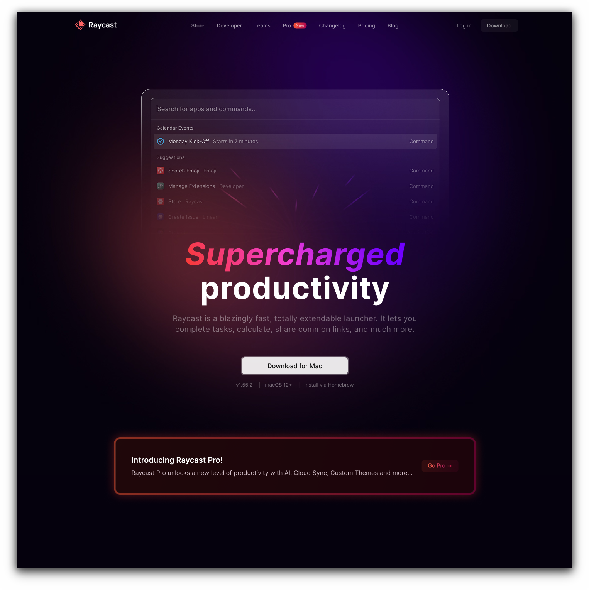
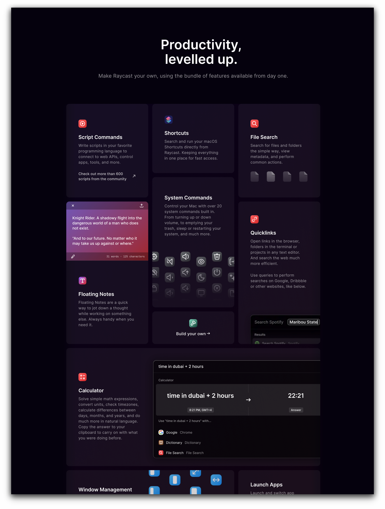
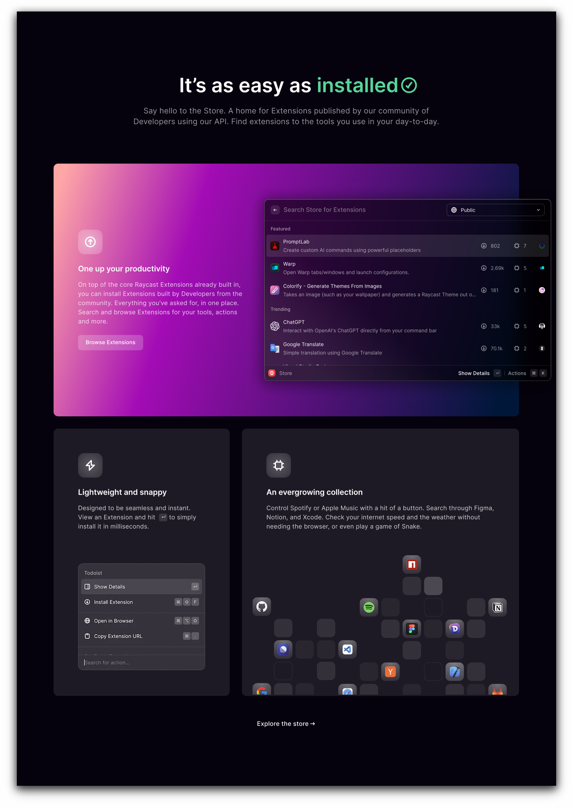
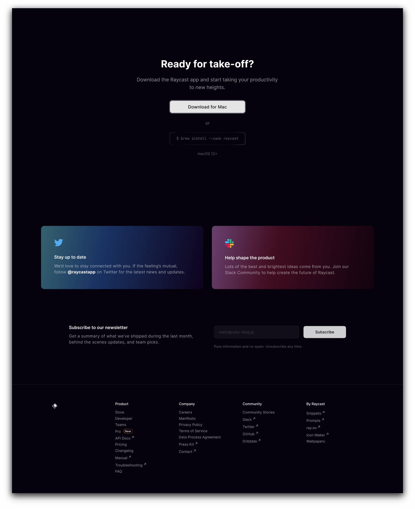
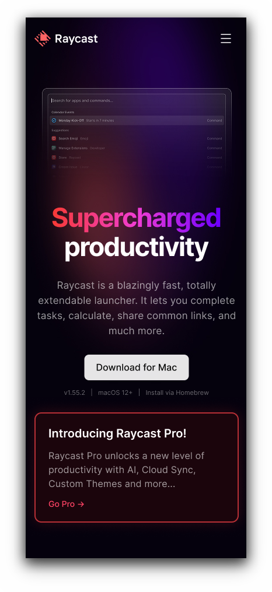

<div align="center">
  

  <h1>Raycast</h1>

  <p>
    <strong>Supercharged productivity, rebuilt for the web.</strong><br>
    A pixel-perfect, responsive recreation of the Raycast landing page —<br>
    taken from a Figma community design and brought to life with React.
  </p>

  <p>
    <a href="https://www.figma.com/community/file/1700769857446737394">
      
    </a>
    
    <a href="https://github.com/Bila-sowa/Raycast/blob/main/LICENSE">
      
    </a>
    <a href="https://github.com/Bila-sowa/Raycast/stargazers">
      
    </a>
  </p>

  <p>
    
    
  </p>
</div>



> [!NOTE]
> This is a front-end showcase and visual mockup, not a working launcher. It is not affiliated with Raycast.

## ✨ Overview

Raycast is a blazingly fast, totally extendable launcher. It lets you complete tasks, calculate, share common links, and much more.

This project recreates that experience for the browser: a dark, atmospheric landing page with a glowing gradient hero, a command-palette mockup, crisp typography, and a layout that feels right on every screen. The goal is simple — make the jump from **Figma to React** feel seamless.

## 🖼️ Preview

<table>
  <tr>
    <td width="50%">
      
    </td>
    <td width="50%">
      
    </td>
  </tr>
  <tr>
    <td width="50%">
      
    </td>
    <td width="50%" align="center">
      
    </td>
  </tr>
</table>

## 🚀 What's inside

<table>
  <tr>
    <td width="50%">
      <strong>🎯 Pixel-perfect by design</strong><br>
      Careful attention to spacing, gradients, and typography keeps the build faithful to Figma.
    </td>
    <td width="50%">
      <strong>📱 Responsive foundation</strong><br>
      A fluid layout with responsive spacing and a mobile-friendly navigation for smaller screens.
    </td>
  </tr>
  <tr>
    <td width="50%">
      <strong>🧭 Sticky navigation</strong><br>
      A header that reacts to scroll and keeps the primary actions within reach.
    </td>
    <td width="50%">
      <strong>🍔 Mobile menu</strong><br>
      A compact burger menu with a focused, animated panel for smaller viewports.
    </td>
  </tr>
  <tr>
    <td width="50%">
      <strong>⚡ Fast by default</strong><br>
      Powered by Vite with a lean React tree, local assets, and production-ready builds.
    </td>
    <td width="50%">
      <strong>🧱 Modular architecture</strong><br>
      Component-scoped SCSS, shared context, reusable hooks, and clean project boundaries.
    </td>
  </tr>
  <tr>
    <td width="50%">
      <strong>🧹 Quality tooling</strong><br>
      ESLint, Stylelint, and Prettier keep the codebase consistent and review-friendly.
    </td>
    <td width="50%">
      <strong>🌍 GitHub Pages ready</strong><br>
      An automated workflow builds, checks, and deploys every push to <code>main</code>.
    </td>
  </tr>
</table>

## 🛠️ Tech stack

| Technology | Role |
| :-- | :-- |
| **React 19** | Component-driven UI |
| **Vite 8** | Development server and production bundling |
| **SCSS** | Design tokens, component styles, and responsive layout |
| **Figma** | Source of truth for the visual design |
| **ESLint · Stylelint · Prettier** | Code quality and formatting |

## ⚡ Getting started

**Prerequisites:** Node.js 20.19+ or 22.12+ and npm.

```bash
# 1. Clone the repository
git clone https://github.com/Bila-sowa/Raycast.git
cd Raycast

# 2. Install dependencies
npm install

# 3. Start the development server
npm run dev
```

Open the local URL printed by Vite — usually <http://localhost:5173/Raycast/>.

### Production build

```bash
npm run build
npm run preview
```

## 📜 Scripts

| Command | Description |
| :-- | :-- |
| `npm run dev` | Start the Vite development server |
| `npm run build` | Create an optimized production build |
| `npm run preview` | Preview the production build locally |
| `npm run compile` | Compile `src/styles.scss` to `src/styles.css` |
| `npm run deploy` | Publish the `dist` folder to GitHub Pages |
| `npm run check:all` | Run ESLint and Stylelint checks |
| `npm run fix:all` | Auto-fix lint issues and format the project |

## 📁 Project structure

```text
Raycast/
├── public/              # Screenshots, favicon, and static assets
├── src/
│   ├── app/             # App entry point and global SCSS architecture
│   ├── assets/          # Product and hero imagery
│   ├── components/      # Header, Hero, Navigation, Announcement, ...
│   ├── context/         # Shared application state
│   ├── hooks/           # Reusable custom hooks
│   └── utils/           # Small helpers and DOM utilities
├── index.html
├── vite.config.js
└── package.json
```

## 🎨 Design source

The visual design comes from the Raycast community file on Figma:

<a href="https://www.figma.com/community/file/1700769857446737394">
  
</a>

## 🤝 Feedback

Found a visual mismatch or have an idea for the build? Open an [issue](https://github.com/Bila-sowa/Raycast/issues) or start a discussion — thoughtful feedback is always welcome.

## 📄 License

Released under the [MIT License](./LICENSE). Designed with inspiration from Raycast. All product names, logos, and brand assets belong to their respective owners.
