  
  

    <h2>Raycast</h2>
  

Raycast is a blazingly fast, totally extendable launcher. It lets you
complete tasks, calculate, share common links, and much more.

> [!NOTE]
> This site is only a visual mockup and does not have any practical functionality.

## Demo

  
  

  <table>
    <tr>
      <td></img></td>
      <td></img></td>
    </tr>
  </table>

  

### Sources

